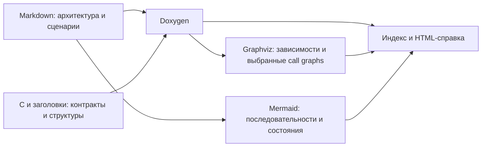

# План подключения Doxygen

[Архитектура](../ARCHITECTURE.md) · [Эксплуатация](OPERATIONS.md)

Markdown-главы описывают взаимодействия, сетевой контракт и файловые форматы. Будущий Doxygen добавит индекс символов, поля структур, контракты функций, ссылки между реализацией и заголовками и автоматически построенные графы. Часть заголовков уже использует `@file`, `@brief`, `@param` и `@return`. Особенно важны файловые дескрипторы, динамические буферы и контексты libuv.

## Порядок внедрения

1. Добавить конфигурацию генератора и отдельную цель `docs` в CMake с явно включаемым режимом. Вывод складывать в каталог сборки. Обычные сборка и CTest должны работать без Doxygen, Graphviz, Node.js и браузера.
2. Включить в справку `ARCHITECTURE.md`, `docs/`, исходники и заголовки из `common/`, `server/` и `client/`. Задать главную страницу, Markdown, HTML и обработку статических функций. Исключить build-каталоги, артефакты анализаторов и зависимости.
3. Зафиксировать версию генератора и проверить обработку Mermaid. Актуальный Doxygen поддерживает блоки `mermaid` в Markdown и режимы обработки `MERMAID_RENDER_MODE`. Выбор режима зависит от требований к офлайн-справке. Для графов включений и выбранных вызовов использовать Graphviz и точечные `@callgraph` и `@callergraph`. [Конфигурация Doxygen](https://www.doxygen.nl/manual/config.html), [команды диаграмм](https://www.doxygen.nl/manual/commands.html), [графы](https://www.doxygen.nl/manual/diagrams.html).
4. Сначала описать контракты функций между модулями. Затем добавить комментарии к регистрации и завершению callbacks, где важно владение. Сверять автоматические графы с базой компиляции, Serena и регистрациями libuv.
5. Добавить отдельную CI-проверку после стабилизации ссылок и предупреждений. Собирать только документацию, сохранять HTML как артефакт и показывать диагностический лог.

## Группы API и контракты

| Группа | С чего начать | Что зафиксировать |
| --- | --- | --- |
| Protocol | `protocol_parse_frame`, `protocol_pack_frame`, `nasfs_frame_t` | Коды возврата, alias входного буфера, кто освобождает packed frame |
| Handshake и auth | `nasfs_handshake_*`, `nasfs_auth_unpack`, `pake_*` | Представление данных, размеры, владение полями, назначение ключей |
| Crypto и формат | `crypto_engine_*`, `protocol_manifest_*` | Размеры входа и выхода, legacy, флаги, момент окончательной проверки |
| Session | `client_session_t`, `session_on_new_connection`, `session_close` | Регистрация, event loop, worker, `pending_fs` и освобождение |
| Storage | `nasfs_storage_t`, `nasfs_storage_begin_upload`, `nasfs_storage_publish_upload` | Владение fd, блокирующие вызовы, требования к каталогу и условия публикации |
| Client | `start_next_operation`, `on_local_read`, `publish_download` | Состояние очереди, временные пути, подтверждение результата, cleanup |
| Lifecycle | `load_config`, `daemonize`, `daemon_notify_ready`, `create_pid_file` | Значения и ошибки, fork, конфигурация путей и владение PID lock |

## Критерии готовности

- Индекс связывает главную страницу с главами и находит ключевые структуры и функции, включая одноимённые `main.c` клиента и сервера.
- В HTML читаются диаграммы PUT, GET и handshake. Вложенные ссылки между Markdown-главами работают.
- Генератор строит выборочные графы переходов по исходникам. Рёбра между регистрацией libuv и callback дополнительно показаны в рукописных диаграммах.
- Генерация из чистой копии воспроизводится в отдельной цели и CI. Бинарные артефакты и выходной HTML остаются в каталоге сборки.
