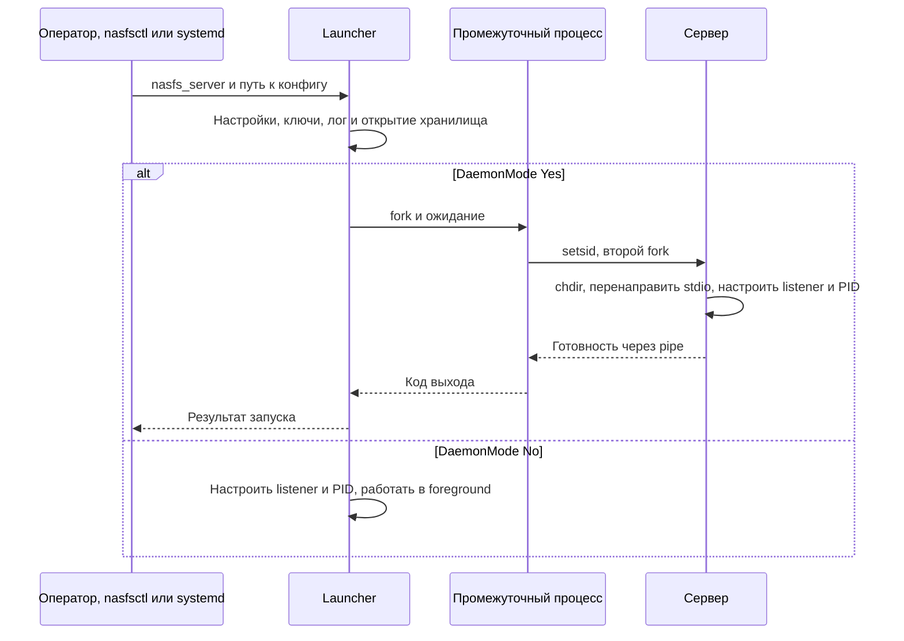

# Сборка, запуск и эксплуатация NASFS

Устройство хранилища и команды для работы с версиями описаны в разделе [Версионные передачи](VERSIONED_TRANSFERS.md).

[Архитектура](../ARCHITECTURE.md) · [Протокол](PROTOCOL.md) · [Передача и хранение](TRANSFERS.md)

## Варианты сборки

Для CMake и Autotools нужны набор инструментов C, `pkg-config` и зависимости `libuv`, `liboqs`, `libsodium`, `openssl`, а также SQLite ≥ 3.38 с заголовками и модулем `sqlite3`, доступным через `pkg-config`. Сервер хранит в SQLite каталог версий и контрольные точки загрузок. Зашифрованные данные лежат в отдельных файлах-контейнерах. Выбранные алгоритмы KEM и подписи должны присутствовать в liboqs. Интеграционные сценарии используют Bash, Python 3 и утилиты командной строки, включая OpenSSL. [CMakeLists.txt](../CMakeLists.txt), [configure.ac](../configure.ac), [хранилище](../server/src/version_store.c), [CI](../.github/workflows/ci.yml).

```sh
cmake -S . -B build-lint -G Ninja -DCMAKE_BUILD_TYPE=Release -DNASFS_INSTALL_SYSTEMD=OFF
cmake --build build-lint
ctest --test-dir build-lint --output-on-failure
```

CMake использует C11, `_POSIX_C_SOURCE=200809L` и экспортирует `compile_commands.json`. `ENABLE_DEBUG=ON` задаёт отладочные флаги. `NASFS_ENABLE_SANITIZERS=ON` включает ASan/UBSan с Clang или GCC. CMake создаёт `nasfs_common`, `nasfs_server` и `nasfs_client`. Он также собирает шесть модульных тестов, `benchmark` и `nasfs_optimizer`. Установка копирует сервер, клиент, скрипт управления, конфиг и при соответствующем флаге systemd unit. Каталоги логов, PID и хранилища создаются при установке.

```sh
./autogen.sh
./configure --disable-systemd
make
make check
```

Autotools собирает программы из `server/` и `client/` с общей архивной библиотекой из `common/`. Сборка определяет `HAVE_CONFIG_H`. `make check` регистрирует пять модульных и три интеграционных теста. Цели теста ECC, микробенчмарка и оптимизатора определены в CMake. Путь systemd unit настраивается `NASFS_SYSTEMD_UNIT_DIR` в CMake или `--with-systemdsystemunitdir` в Autotools. [Настройки Autotools](../configure.ac), [установка](../Makefile.am), [список тестов](../tests/Makefile.am).

## Серверный конфиг

`nasfs_server [config]` читает явный путь или `nasfs.conf` в текущем каталоге. Для чтения встроенных значений по умолчанию нужен доступный файл, допустим пустой. `nasfs_server --daemon-mode [config]` только загружает настройки и печатает `yes` или `no`. Скрипт управления использует эту команду перед запуском.

Формат — директива и значение через пробельный разделитель. `#` начинает комментарий вне двойных кавычек. Двойные кавычки позволяют сохранить пробелы и `#`. Внутри поддерживается экранирование кавычек и обратной косой черты. Некавыченный вариант использует первый токен. Строки до 4096 байт, встроенный NUL отклоняется. Повторная известная директива задаёт новое значение. Директива `AuthPassword` без значения очищает пароль. Пустая строка в кавычках разбирается как строковое значение. [Парсер](../server/src/config/config.c).

| Директива | Встроенное значение | Шаблон установки и назначение |
| --- | --- | --- |
| `ListenAddr` | `127.0.0.1` | `0.0.0.0`, IPv4-адрес listener |
| `Port` | `5252` | `5252`, 0 запрашивает свободный порт у ОС |
| `MaxConn` | 10 | 5, предел живых сессий и параметр backlog |
| `ClientTimeout` | 30 с | 60 с, простой серверной сессии |
| `LogFile` | `/var/log/nasfs-server.log` | Под `localstatedir/log/nasfs`. Недоступный log file останавливает запуск |
| `LogLevel` | `Debug` (0) | `Debug`. Доступны Debug, Info, Warning, Error |
| `DaemonMode` | No | Yes, отделиться от терминала |
| `PidFile` | `/var/run/nasfs-server.pid` | Под `localstatedir/run/nasfs` |
| `StorageDir` | `.` | Под `datadir/nasfs/storage`, корень данных |
| `KexAlgorithms` | `ML-KEM-512,Kyber512,ML-KEM-768,Kyber768` | Такой же список, ограничения для выбора профиля |
| `CipherAlgorithms` | `xchacha20poly1305` | Такой же список, управляющее шифрование |
| `AuthMethods` | `password,publickey,password+publickey` | `publickey`, включённые способы допуска |
| `AuthPassword` | Отсутствует | Закомментирован. Для password и PAKE нужен заданный пароль |
| `AuthorizedKeysFile` | `/usr/local/etc/nasfs/authorized_keys` | `sysconfdir/nasfs/authorized_keys` |
| `PubKeyAuthAlgorithms` | `ML-DSA-65,ML-DSA-44` | Такой же список, допустимые подписи логина |
| `ServerSigningSeed` | Путь из окружения при отсутствии директивы | Абсолютный путь к Ed25519 seed сервера |
| `AuthorPublicKey` | Путь из окружения при отсутствии директивы | Абсолютный путь к публичному ключу автора |
| `VersionRetentionSeconds` | 86400 с | 86400 с, срок хранения заменённых версий до очистки через `collect` |
| `AttemptRetentionSeconds` | 86400 с | 86400 с, срок хранения контрольной точки PUT или сохранённого результата |
| `VersionQuotaBytes` | 0 | 0 отключает лимит на суммарный объём контейнеров и активных резервирований |

[Встроенные настройки](../server/src/config/config.c), [поставляемый конфиг](../server/config/nasfs.conf.in), [логирование](../server/src/logging/log.c).

## Запуск и остановка



- До отделения процесс приводит относительные `LogFile`, `PidFile` и `AuthorizedKeysFile` к исходному каталогу. `StorageDir` открывается до `chdir("/")`. Ключи читаются на старте. Логгер проверяет путь на старте и открывает файл для записей в режиме append.
- Listener начинает слушать до записи PID. `pid_file.c` удерживает lock на открытом fd. При штатной остановке сервер удаляет принадлежащий ему PID-файл. В daemon-режиме ошибка до готовности приводит к EOF в status pipe, ожиданию дочернего процесса и проверке PID-файла на очистку.
- `nasfsctl start` запрашивает режим у бинарника. Для daemon-режима он ждёт результата launcher. Для foreground запускает процесс в фоне и ждёт появления подходящего PID. `stop` посылает SIGTERM после проверки PID и командной строки. `restart` запускается после успешного stop. Скрипт использует пути установки. При запуске через sudo он удаляет из окружения пути к ключам из `NASFS_SERVER_SIGNING_SEED` и `NASFS_AUTHOR_PUBLIC_KEY`, поэтому привилегированный запуск использует пути из конфига.
- Поставляемый systemd unit использует `Type=forking`, `PIDFile` и `Restart=on-failure`. Путь к PID должен совпадать с конфигом. В шаблоне `ExecStart` пути бинарника и конфига заключены в кавычки. `ExecStop` отправляет SIGTERM. При изменении префикса связи между путями задаются на этапе конфигурации сборки.
- Серверный SIGINT или SIGTERM останавливает основной `uv_run`. Затем `uv_walk` запрашивает закрытие handles. Второй `uv_run` завершает callbacks, после чего закрываются loop, storage fd и PID-файл. Клиент при сигнале возвращает `128 + signum` и очищает staging GET.

[Сервер](../server/src/main.c), [daemonize](../server/src/utils/daemon.c), [PID-файл](../server/src/utils/pid_file.c), [nasfsctl](../utils/nasfsctl.in), [systemd unit](../systemd/nasfs.service.in).

## Ключевой материал и окружение

| Что нужно | Где используется |
| --- | --- |
| 32-байтовый Ed25519 seed сервера | `ServerSigningSeed` или `NASFS_SERVER_SIGNING_SEED` у сервера |
| Публичный ключ сервера | `$HOME/.nasfs/server-<ipv4>-<port>.pub` у CLI |
| 32-байтовый Ed25519 seed автора | `NASFS_AUTHOR_SIGNING_SEED` у PUT |
| Публичный ключ автора | `AuthorPublicKey` или `NASFS_AUTHOR_PUBLIC_KEY` у сервера. `NASFS_AUTHOR_PUBLIC_KEY` у GET |
| Пара ключей логина | `nasfs_client keygen <private> <public> [algorithm]`. Публичная строка `algorithm hex` идёт в allowlist, приватный файл используется через `NASFS_IDENTITY_FILE` |
| Пароль открываемого файла и `master.salt` | `NASFS_ENCRYPTION_KEY` и `$HOME/.nasfs/master.salt` у CLI |
| Пароль входа | `AuthPassword` у сервера и `NASFS_AUTH_PASSWORD` у CLI для парольных способов |

Ed25519-файлы содержат ровно 32 сырых байта. `nasfs_handshake_read_key` проверяет обычный файл, владельца, длину и права. Проверка seed запрещает доступ группы и остальных. Для публичного ключа запрещена запись группы и остальных. Приватный формат `keygen` содержит заголовок `NASFS-MLDSA-PRIVATE-v1`, имя алгоритма, публичный и секретный hex на отдельных строках. Лимиты NASFS для этого формата составляют 127 байт имени алгоритма, 4096 байт публичного и 4999 байт секретного ключа до hex-кодирования. Тип и ожидаемые размеры дополнительно сверяются с liboqs. `keygen` записывает и синхронизирует два staging-файла, затем публикует их через `link` без замены. При отказе второй публикации выполняется попытка удалить первое имя. CLI требует, чтобы пароль файла отличался от пароля входа, если заданы оба. [Штатные примеры подготовки ключей](../README.md#server-identity), [чтение ключей](../common/src/handshake.c), [генерация](../client/src/main.c), [чтение identity](../client/src/client.c).

### Выбор CLI

| Переменная | Значение по умолчанию и влияние |
| --- | --- |
| `NASFS_SERVER_IP`, `NASFS_SERVER_PORT` | `127.0.0.1`, `5252`. Определяют TCP endpoint и имя pin |
| `NASFS_KEX_ALGORITHMS`, `NASFS_CIPHER_ALGORITHMS` | Списки предложения handshake. По умолчанию четыре KEM-профиля и `xchacha20poly1305` |
| `NASFS_AUTH_METHOD`, `NASFS_AUTH_USER` | `password`, `user`. CLI поддерживает `password`, `publickey`, `password+publickey` и `pake`. Для поставляемой серверной политики задаётся `publickey` |
| `NASFS_AUTH_SIG_ALGORITHM` | `ML-DSA-65`, алгоритм подписи логина |
| `NASFS_FILE_CIPHER` | `xsalsa20poly1305`. Допустимы также `xchacha20poly1305` и `aes256gcm`. GET берёт алгоритм из метаданных |
| `NASFS_FILE_HASH` | `blake2b`. Допустимы также `sha256` и `blake3`. GET берёт алгоритм из метаданных |
| `NASFS_KDF` | `argon2id`, единственное поддерживаемое значение |
| `NASFS_BLOCK_SIZE` | 65536, от 4096 до 4194304. Размер блока нового PUT |
| `NASFS_ECC` | `off`. Для PUT доступны также `xor-4+1`, `xor-8+1`, `xor-16+1` и `rs-8+2` |
| `NASFS_EXPECTED_MANIFEST` | 64 hex-цифры ожидаемого digest при одиночном GET |

`put <local> [remote]` берёт имя из basename локального пути при отсутствии аргумента. `get <remote> [local]` по умолчанию пишет в basename удалённого имени. `mput <local>...` выбирает удалённые имена по basename и требует свободных имён. У `mget <local>...` аргументы задают локальные пути, удалённые имена берутся из basename. В пакетах максимум 512 операций. При отказе дальнейшая очередь прекращается. Уже успешно опубликованные элементы сохраняются. [CLI](../client/src/main.c), [API](../client/include/nasfs_client.h).

## Проверки, CI и измерения

| Где искать | Что проверяется или измеряется |
| --- | --- |
| [unit_handshake](../tests/test_handshake.c), [unit_auth](../tests/test_auth.c), [unit_pake](../tests/test_pake.c) | Кодеки, выбор профиля, аутентификация и получение общего PAKE-ключа |
| [unit_encryption](../tests/test_encryption.c), [unit_config](../tests/test_config.c), [unit_ecc](../tests/test_ecc.c) | Криптография, фрейминг и манифест, директивы сервера, восстановление XOR |
| [integration_e2e](../tests/test_end_to_end.sh) | PUT/GET с побайтовой проверкой, методы входа, совпадения имён и пакетные операции |
| [integration_encryption](../tests/test_file_encryption.sh) | Ключи и соли, варианты шифра и хеша, локальная и серверная публикация, восстановление |
| [integration_lifecycle](../tests/test_lifecycle.sh) | Запуск, сигналы, PID, daemon readiness и локальная проверка скрипта управления |
| [Сценарий systemd](../tests/test_systemd.sh) | Отдельный запуск с Linux user manager и установленным префиксом. Есть перенос данных и рестарт |
| [Fault injection](../tests/fault_injection.c), [transfer recovery](../tests/test_transfer_recovery.py) | Управляемые отказы и задержки I/O, обрыв и наблюдение за итогом операции в интеграционных тестах. Часть путей доступна на Linux |
| [benchmark](../tests/benchmark.c), [nasfs_optimizer](../utils/nasfs_optimizer.c) | Локальные измерения примитивов и компонентов |
| [benchmark_e2e](../tests/benchmark_e2e.sh), [blocksize](../tests/benchmark_blocksize.sh), [IOPS](../tests/benchmark_iops.sh) | Передачи целиком, влияние размера блока и серий мелких файлов. SFTP зависит от доступной доверенной SSH-сессии |

[GitHub Actions](../.github/workflows/ci.yml) устанавливает зависимости на Ubuntu runner и запускает lint, Autotools, CMake и сборку с ASan/UBSan. При чтении замеров учитывай настройки бенчмарка. Таймер end-to-end NASFS включает запуск CLI, Argon2id, соединение, аутентификацию и перенос. Скрипт проверяет данные GET. Для локальных статических анализаторов, clangd и Joern см. [ANALYSIS.md](../ANALYSIS.md).

## Где искать причину сбоя

| Симптом | Проверка |
| --- | --- |
| Сервер завершился до listener | Прочитать stderr и лог. Сверить путь к конфигу, право открыть лог, ключи и каталог хранения |
| Включён daemon-режим, процесс не готов | Проверить конфликты порта и права на PID-файл. Launcher возвращает отказ по pipe |
| Клиент завершается до TCP | Проверить pin для фактического IPv4:порт, `master.salt`, окружение, ключ автора и совместимость настроек CLI |
| Handshake не согласован | Сверить предложение, серверную политику и алгоритмы в liboqs обеих сборок |
| Вход не принят | Сверить `AuthMethods`, пароль или строку ключа и алгоритм в allowlist |
| PUT принят, но имени нет | Проверить `PUT_RESULT` и серверный лог, права на каталог версий, режим запроса, свойства ФС и допустимость замены |
| CLI сообщает неизвестный итог PUT | Выполнить проверочный GET. Если есть ожидаемый digest, закрепить его через `NASFS_EXPECTED_MANIFEST` |
| GET не публикует файл | Сверить пароль, исходный KDF и соль, ключ автора, целостность контейнера и права локального назначения |
