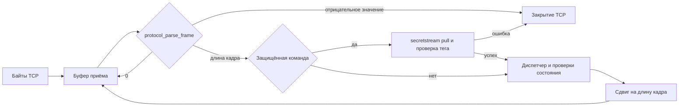
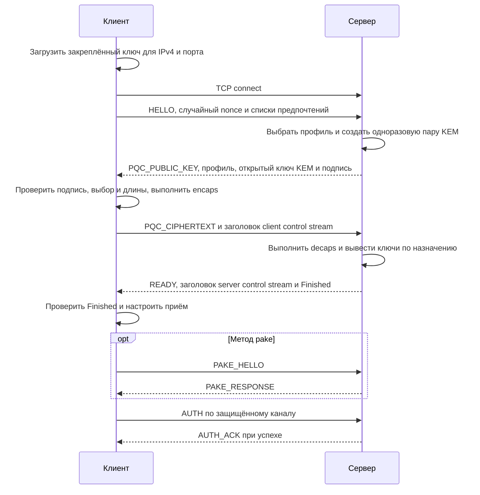
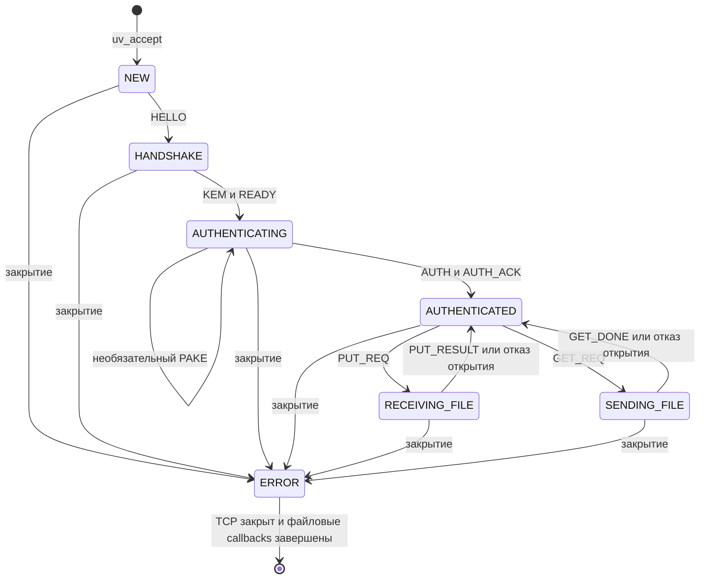

# Протокол, защищённый канал и вход

Описание файловых кадров ниже фиксирует `ref/api`. В этой ветке действующий формат и команды описаны в [Версионных передачах](VERSIONED_TRANSFERS.md). Рукопожатие и AUTH используют тот же транспорт.

[Архитектура](../ARCHITECTURE.md) · [Передача и хранение](TRANSFERS.md) · [Эксплуатация](OPERATIONS.md)

## Фрейминг поверх TCP

```text
offset     0                        4          5
bytes      [u32 length, big-endian] [u8 type]  [payload, length - 1]
wire size  4 + length
```

Поле `length` включает команду. Кодек допускает значения от 1 до 16 МиБ включительно. `protocol_parse_frame` возвращает число потреблённых байт, 0 при неполном кадре и отрицательное значение при ошибке формата. `frame.payload` ссылается внутрь входного буфера. Обработчик должен употребить данные до сдвига или перераспределения буфера. `protocol_pack_frame` возвращает отдельную аллокацию, которую передающий код удерживает до завершения `uv_write`. [Кодек](../common/src/protocol.c), [интерфейс](../common/include/protocol.h).

Оба обработчика начинают расчёт ёмкости с 16 КиБ и увеличивают её до размера, достаточного для запроса libuv. Верхняя граница составляет 64 МиБ. Один TCP callback может принести часть кадра или несколько кадров, поэтому обработчики разбирают всё доступное и оставляют остаток. При заполненной очереди PUT сервер приостанавливает разбор и TCP-чтение. Во время финализации PUT следующие кадры ждут в буфере. [Сервер](../server/src/network/session.c), [клиент](../client/src/client.c).



## Установление соединения



Сервер перебирает предложения клиента в заданном им порядке, учитывает собственную политику и доступность реализации. В коде закреплены профили `ML-KEM-512` (1), `ML-KEM-768` (2), `Kyber512` (3), `Kyber768` (4). Доступность KEM зависит от сборки liboqs. Реализованный управляющий шифр — `xchacha20poly1305` через libsodium secretstream. [Выбор на сервере](../server/src/network/session.c), [профили, transcript и вывод ключей](../common/src/handshake.c).

Подпись Ed25519 охватывает transcript с хешем байтов HELLO и байтами выбора до подписи. Из секрета KEM и transcript выводятся отдельные 32-байтовые значения для клиентского control stream, серверного control stream, серверного Finished и контекста клиентского AUTH. Finished связывает хеш payload `PQC_CIPHERTEXT` с серверным заголовком потока. Клиент проверяет его перед AUTH или PAKE. Размеры KEM-полей определяет выбранный алгоритм. В коде хеши transcript и Finished используют 32-байтовый результат BLAKE2b. Transcript включает строку домена с завершающим NUL, хеш HELLO и хеш selection. Параметр назначения для производных значений задан перечислением `nasfs_handshake_key_purpose_t`. [Кодек handshake](../common/src/handshake.c), [обработчики](../client/src/client.c).

Команды `0x10–0x1F` проходят через secretstream после handshake. Байт команды передаётся как associated data и проверяется вместе с payload. Приём ожидает тег `TAG_MESSAGE`. Сервер посылает `ERROR` открытым при несовместимом handshake и защищённым после установки канала. `PUT_DATA` и `GET_DATA` несут шифротекст файла напрямую. Внешний тип и длина кадра видны на транспорте.

## Справочник команд

Поля в таблице описаны до применения secretstream. `u16be`, `u32be` и `u64be` обозначают целые числа в сетевом порядке. Для `name` нужен один компонент пути. Текущий CLI добавляет завершающий NUL. Сервер принимает имя и без него.

| Код | Команда | Направление | Payload и применение |
| --- | --- | --- | --- |
| `0x05` | `HELLO` | C → S | 32 байта nonce, две длины u16be, CSV KEM и CSV шифров |
| `0x02` | `PQC_PUBLIC_KEY` | S → C | Две длины u16be, имя KEM и шифра, публичный ключ KEM, байт профиля, подпись Ed25519 (64 байта) |
| `0x03` | `PQC_CIPHERTEXT` | C → S | Шифротекст KEM и 24-байтовый заголовок клиентского secretstream |
| `0x06` | `READY` | S → C | 24-байтовый заголовок серверного secretstream и 32 байта Finished |
| `0x10` | `AUTH` | C → S | Шесть полей с префиксами u32be, см. ниже |
| `0x11` | `AUTH_ACK` | S → C | Пустой payload. Соединение допущено к файловым операциям |
| `0x12` | `PUT_REQ` | C → S | Версия/режим (2 или 3), соль (16), размер plaintext (u64be), cipher (1), hash (1), owner slot (72), имя |
| `0x13` | `PUT_ACK` | S → C | Пустой payload. Сервер открыл staging и записал заголовок и слот |
| `0x18` | `PUT_BLOCK_META` | C → S | Номер блока (u64be), длина шифротекста (u32be), хеш (32) |
| `0x20` | `PUT_DATA` | C → S | Шифротекст блока. Следует за его метаданными |
| `0x14` | `PUT_DONE` | C → S | Манифест (32 байта digest и 64 байта подписи) |
| `0x1C` | `PUT_RESULT` | S → C | Один байт. 0 — имя опубликовано. 1 — отказ финализации. При обрыве, ошибке I/O до публикации или закрытии ответ может отсутствовать |
| `0x15` | `GET_REQ` | C → S | Байт режима 2 и имя |
| `0x16` | `GET_ACK` | S → C | Соль (16), размер plaintext (u64be), cipher с переносимым флагом при наличии (1), hash (1), необязательный слот (72) |
| `0x19` | `GET_BLOCK_META` | S → C | Та же структура из 44 байт |
| `0x21` | `GET_DATA` | S → C | Шифротекст блока из контейнера |
| `0x17` | `GET_DONE` | S → C | Манифест длиной 96 байт, для старого неподписанного контейнера пустой payload |
| `0x1A` | `PAKE_HELLO` | C → S | Длина имени u8, имя, 32-байтовая клиентская доля X |
| `0x1B` | `PAKE_RESPONSE` | S → C | 32-байтовая серверная доля Y |
| `0xFF` | `ERROR` | S → C | Текст причины, обработчик клиента завершает соединение |

Порядок и направления проверены по [перечислению](../common/include/protocol.h), [серверному диспетчеру](../server/src/network/session.c) и [клиентскому обработчику](../client/src/client.c). Длины сообщений и флаги на диске имеют разные назначения, см. [контейнер](TRANSFERS.md).

## AUTH и состояние сервера

Поля AUTH идут в порядке `method, username, password, sig_algorithm, public_key, signature`. Каждое поле начинается с u32be длины. Строки передаются без завершающего NUL, а декодер выделяет память и добавляет терминатор для локального использования. `nasfs_auth_payload_free` освобождает разобранные поля. [Кодек AUTH](../common/src/auth.c).

| Метод | Данные и проверка |
| --- | --- |
| `password` | Поле password содержит hex доказательства, привязанного к текущему handshake. Обе стороны получают материал из общего пароля с Argon2id. Сервер сравнивает вычисленное доказательство. При отсутствующем `AuthPassword` этот способ входа отключён |
| `publickey` | Клиент подписывает сообщение с методом, именем и контекстом текущего handshake. Сервер сверяет алгоритм с политикой, публичный ключ с allowlist и подпись с liboqs |
| `password+publickey` | Выполняются парольная проверка и проверка подписи |
| `pake` | В уже защищённом канале стороны обмениваются долями SPAKE2 на Ristretto255. Сервер проверяет доказательство, переданное через AUTH |



Операции проверяют состояние сессии и наличие активного fd. При неверном порядке, ошибке secretstream, неизвестной команде, обрыве TCP или истечении таймера сервер может закрыть сессию сразу. Сообщение `ERROR` используется на части путей. При запуске таймер сервера с секундным шагом проверяет простой по `ClientTimeout`, а CLI обслуживает свой 30-секундный таймаут. [Структура и состояния](../server/include/network/session.h), [серверный таймер](../server/src/main.c), [таймер и обработка ошибок клиента](../client/src/client.c).
