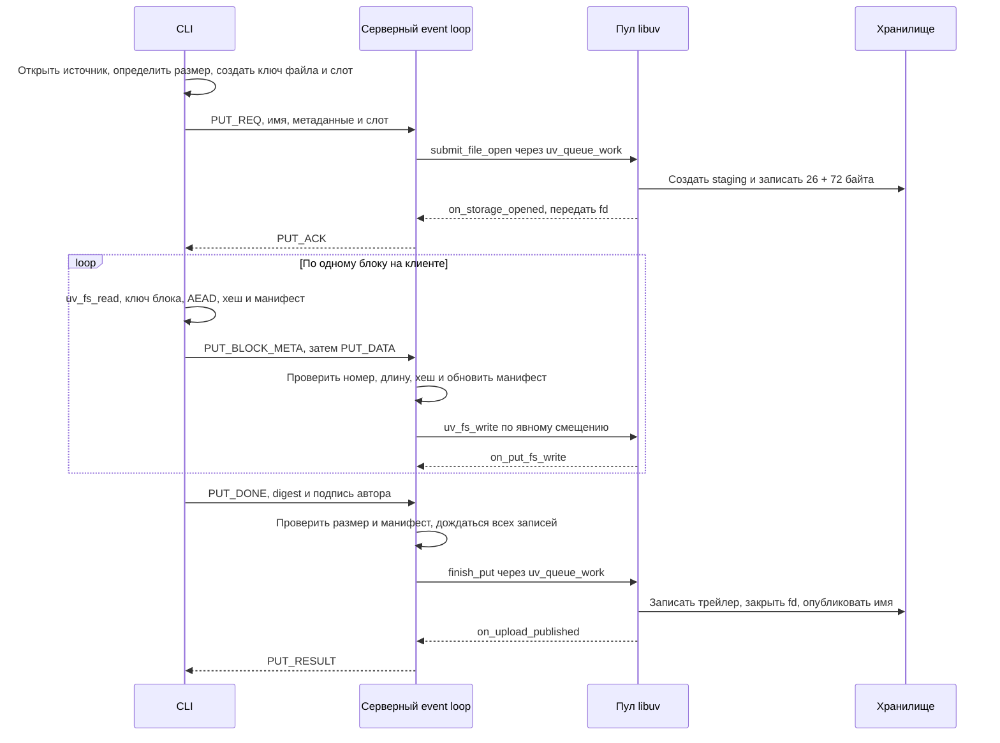
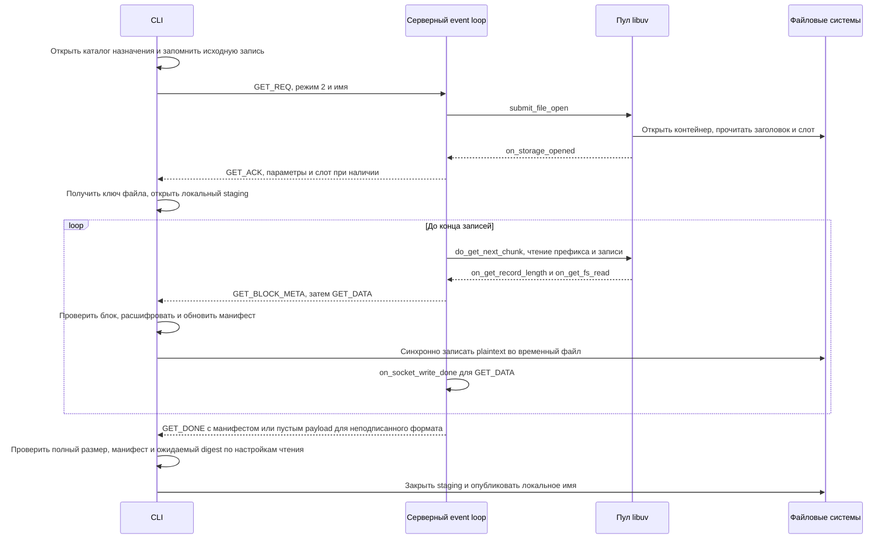
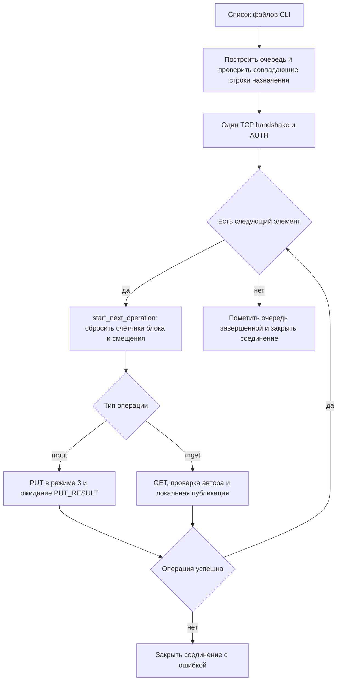
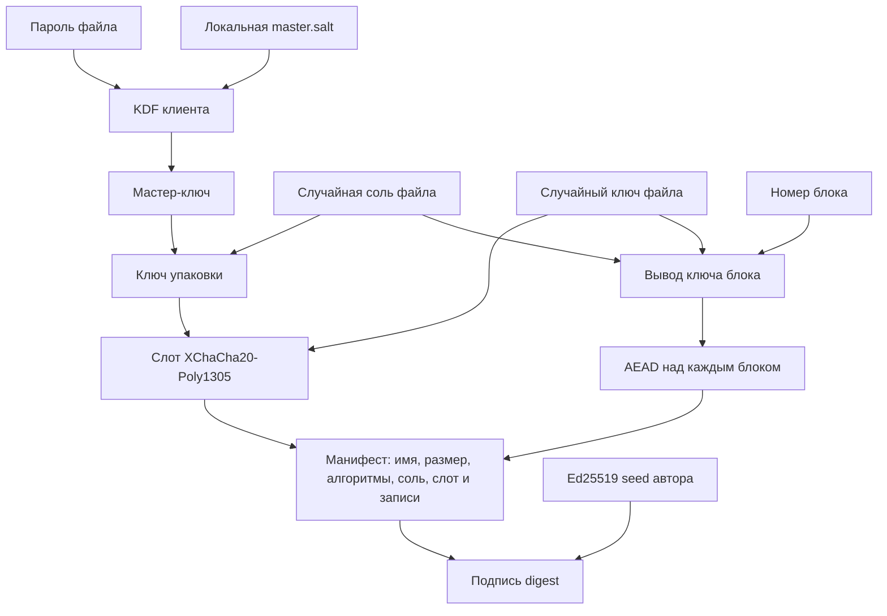
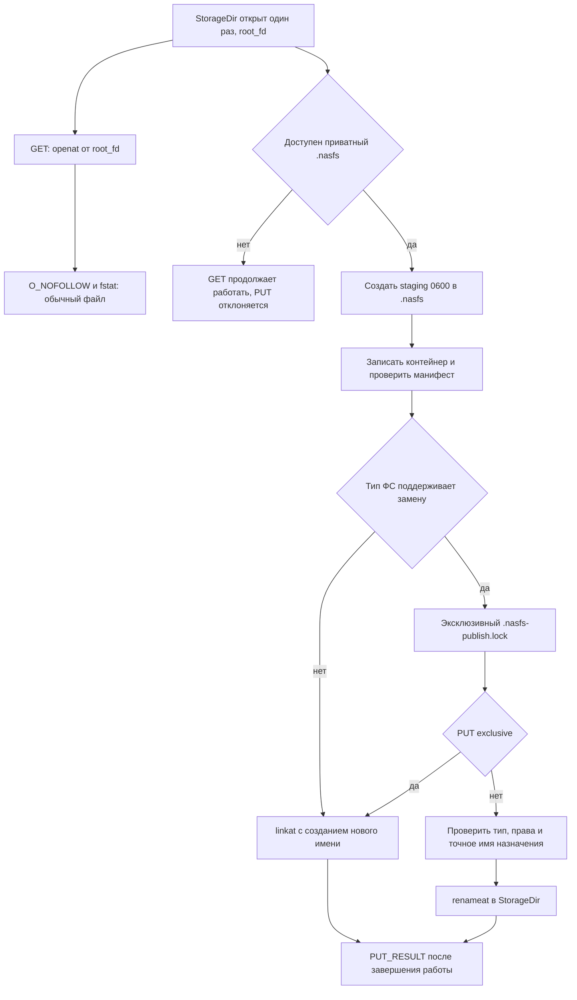
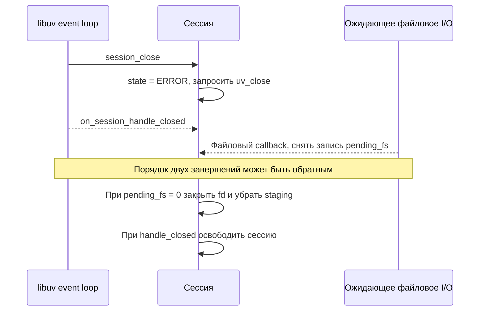

# Передача файлов, контейнеры и публикация

Эта глава описывает передачи ветки `ref/api`. Действующий формат новой ветки описан в [Версионных передачах](VERSIONED_TRANSFERS.md).

[Архитектура](../ARCHITECTURE.md) · [Протокол](PROTOCOL.md) · [Эксплуатация](OPERATIONS.md)

## PUT от локального файла до опубликованного имени



1. `start_next_operation` сбрасывает счётчики и передаёт управление `send_put_req`. В одиночном PUT режим запроса 2 допускает замену там, где хранилище её поддерживает. В `mput` режим 3 означает создание нового имени.
2. Сервер проверяет состояние, поля и имя. `open_storage_object` создаёт staging и пишет метаданные до ACK. `on_storage_opened` передаёт открытый fd сессии или очищает результат, если TCP уже закрывается.
3. Клиент читает через `do_put_read_chunk → on_local_read`. Успешный callback отправки `PUT_DATA` запускает чтение следующего блока. Сервер может держать до четырёх ожидающих файловых записей. При достижении лимита `process_session_frames` останавливает чтение. `finish_file_request` после завершения обрабатывает накопленные байты и возобновляет чтение при наличии места.
4. Короткая или неуспешная запись завершает сессию. На EOF CLI сверяет общий размер с объявленным и подписывает накопленный манифест. Сервер в `PUT_DONE` проверяет число байт, отсутствие незавершённой пары metadata/data и подпись доверенного автора. Затем запись трейлера и публикация выполняются после всех `uv_fs_write`.
5. Клиент считает PUT успешным после `PUT_RESULT = 0`, выводит digest и может начать следующий элемент очереди. Если CLI уже отправил `PUT_DONE`, но подтверждение потерялось, он сообщает неизвестный результат. Предварительный `PUT_ACK` означает, что сервер готов принимать блоки. После постановки публикации в рабочий пул она может завершиться при закрытом соединении.

Пустой источник тоже проходит PUT: клиент подписывает манифест заголовка и слота, сервер пишет трейлер без записей данных. [Клиентский цикл](../client/src/client.c), [серверный цикл](../server/src/file_service.c).

## GET до появления локального файла



В контейнерах с длинами сервер сначала читает префикс, потом ровно соответствующий блок. Для legacy без префиксов размер чтения определяется серверным `BlockSize` и 16-байтовым накладным расходом шифра. `on_get_fs_read` сам вычисляет metadata для отправки. Успешное завершение `uv_write` кадра `GET_DATA` запускает следующее чтение. При подписанном контейнере `on_get_manifest` требует ровно 96 оставшихся байт трейлера. `GET_DONE` переводит сервер обратно в `AUTHENTICATED`. [Сервер](../server/src/network/session.c).

Клиент получает публичный ключ Ed25519 автора отдельно от trust pin сервера. Перед созданием локального staging он открывает owner slot или выводит ключ для старого контейнера без слота. Для каждого блока проверяет метаданные, хеш, AEAD и границы ожидаемого plaintext. `GET_DONE` проверяет отсутствие неполной пары metadata/data, полный размер, подпись и при наличии `NASFS_EXPECTED_MANIFEST` совпадение digest. Пустой манифест допускается только для контейнера без слота при `NASFS_ALLOW_UNSIGNED_READ=1` и без закреплённого digest. Длина GET определяется заголовком контейнера, блоки PUT следуют настройке клиента. [Клиент](../client/src/client.c).

### Локальная публикация GET

`prepare_download` открывает каталог назначения до `GET_REQ` и фиксирует исходное состояние имени. После проверки ключа `open_download_file` создаёт файл 0600 в проверенном каталоге `.nasfs-client.<uid>` на той же ФС. `publish_download` сверяет inode через fd файла и staging, закрывает файл и сверяет открытый каталог назначения с текущим путём. Новое имя создаётся атомарно через `linkat`. Если оно занято, операция завершается ошибкой и сохраняет существующее назначение.

Для замены клиент берёт эксклюзивный `flock` на открытом для записи файле `.publish.lock` в приватном staging. Клиент сверяет device, inode, размер, mtime и ctime с наносекундами с исходным снимком и проверяет право записи перед `renameat`. Вызовы проверки и замены раздельны. Сторонним писателям нужна та же координация, чтобы гарантировать отсутствие правки в этом интервале. `mget` отслеживает inode опубликованных файлов для выявления алиасов. При отмене staging удаляется через сохранённый fd. Принудительная остановка без выполнения callbacks может оставить временный файл. [Клиентская публикация](../client/src/client.c).

## Пакетные операции в одном соединении



`batch_queue` хранит локальный путь и удалённое имя для каждого элемента. После `AUTH_ACK` запускается первый запрос. Следующий PUT начинается после подтверждения публикации. Следующий GET начинается после локальной публикации текущего результата. Сервер возвращается в `AUTHENTICATED` на границе каждого объекта. Границы транзакции совпадают с отдельными файлами, поэтому завершившиеся операции видны сразу и сохраняются при отказе более позднего элемента. [Клиентский диспетчер](../client/src/client.c), [переходы состояния сервера](../server/src/network/session.c).

## Формат контейнера

```text
Новый PUT
  [u64be plaintext size][16 байт file salt][u8 cipher | flags][u8 hash]
  [72 байта owner slot]
  [u32be length][ciphertext]  повторяется для каждого блока
  [u32be zero][32 байта digest][64 байта подписи Ed25519]
```

Заголовок всегда занимает 26 байт. Байты 0–7 хранят исходный размер, 8–23 — соль, 24 — шифр с признаками, 25 — алгоритм хеша блока. В этом заголовке размер идёт первым. В `PUT_REQ` и `GET_ACK` первой идёт соль.

| Признак в байте шифра | Что меняет |
| --- | --- |
| `0x80` `NASFS_FILE_RECORD_LENGTHS` | У каждой записи есть префикс длины u32be |
| `0x40` `NASFS_FILE_MANIFEST` | Нулевая длина обозначает начало 96-байтового подписанного трейлера |
| `0x20` `NASFS_FILE_OWNER_SLOT_V1` | После заголовка есть 72-байтовый слот |
| `0x10` `NASFS_FILE_CIPHER_PORTABLE` | Размер на диске и счётчик в криптографии блоков переносятся между порядками байтов |

Размер ненулевой записи нового контейнера больше 16 и ограничен `4 МиБ + 16 байт`. Хеш вычисляется над шифротекстом. Adler32 и CRC32 занимают четыре байта в 32-байтовом поле. Остальную часть обнуляет вызывающий код. BLAKE2b и SHA-256 заполняют 32 байта. [Границы](../server/src/file_service.c), [хеши](../common/src/crypto_engine.c), [флаги](../common/include/protocol.h).

### Ключи и подпись



- Мастер-ключ выводится на клиенте до подключения. Первый PUT может создать 16-байтовый `$HOME/.nasfs/master.salt` через приватный staging, `fsync`, атомарный `linkat` и перечитывание опубликованного значения. После чтения клиент синхронизирует каталоги. При GET требуется существующая соль. Для повторного чтения нужны исходные соль, пароль и KDF.
- NASLUKS v1 хранит 24-байтовый nonce, зашифрованный 32-байтовый ключ файла и 16-байтовый тег. Ключ упаковки выводится из мастер-ключа и соли файла. При упаковке соль файла также служит associated data, а при обработке данных участвует в выводе отдельных ключей блоков. Данные блоков используют XSalsa20-Poly1305, XChaCha20-Poly1305 или AES-256-GCM, каждый с накладным расходом 16 байт.
- Манифест начинает BLAKE2b-256 с домена `NASFS ciphertext manifest/1`, пары cipher/hash, размера u64be, соли и имени с завершающим NUL. При наличии слота добавляются маркер NASLUKS v1 и слот. Далее идут префикс длины и шифротекст каждой записи. Нулевой префикс трейлера служит разделителем. Подпись Ed25519 связывает digest с автором. Клиент получает и проверяет манифест через `GET_DONE`, сервер проверяет его при `PUT_DONE`.

[Криптография](../common/src/crypto_engine.c), [подписываемые байты](../common/src/protocol.c), [соль и выбор ключей](../client/src/client.c).

### Варианты чтения

| Контейнер | Как его читают |
| --- | --- |
| Современный portable NASLUKS v1 | Заголовок и счётчик переносимы. Есть префиксы, слот и подпись. Текущий CLI пишет этот формат с Argon2id |
| Старый NASLUKS со слотом | Заголовок и счётчик требуют соответствующего прежнему порядку байтов. Используется исходный KDF, включая старые варианты HKDF и PBKDF2 |
| Подписанный контейнер без слота | Для ключа файла сохраняется старый вывод HKDF из мастер-ключа и соли файла |
| Неподписанный контейнер с префиксами или неявными границами | Требуется `NASFS_ALLOW_UNSIGNED_READ=1`. Для неявных границ нужен серверный `BlockSize`, соответствующий размеру блоков при исходном PUT |

Гибкость чтения относится к формату на диске. Новые управляющие кадры, handshake и режимы запроса требуют совместимых версий клиента и сервера. Примеры старых форматов есть в [фикстурах](../tests/fixtures/) и проверяются в [integration_encryption](../tests/test_file_encryption.sh).

## Серверное хранилище и конкуренция



- Имена плоские, до 255 байт, запрещены `.`, `..`, разделители `/` и обратный слеш, внутренний NUL и служебные имена. Проверка служебного префикса и имён учитывает ASCII-регистр. Разрешение объектов идёт относительно открытого fd корня. GET проверяет тип по дескриптору и использует `O_NOFOLLOW`.
- Служебный каталог создаётся с 0700. Открытие проверяет владельца, режим и нахождение на том же устройстве. Для корня требуются ожидаемый владелец и отсутствие записи для группы/остальных, на macOS учитываются extended ACL.
- Уборка staging при старте сканирует служебный каталог под эксклюзивным `flock`. Проверяются точный префикс, случайный суффикс, тип и владелец. Уборка удаляет проверенные staging-имена, в том числе ссылку, оставшуюся после успешного `linkat` при create-only PUT. Опубликованное имя сохраняется. Сервер использует имена, подходящие для уборки, пока держит общую блокировку каталога. Если блокировка недоступна или обнаружен NFS, используется `.nasfs-upload.unlocked.*`, на который уборка не распространяется.
- Для локальной замены Linux проверяет тип файловой системы (ext4, XFS, Btrfs, tmpfs, overlayfs, F2FS), macOS — `MNT_LOCAL`. Замена сериализуется блокировкой `.nasfs-publish.lock`. Для существующего объекта проверяются тип, владелец, права и совпадение имени. На macOS учитываются ACL и особенности имён, в том числе проверка по digest существующего манифеста вне APFS.
- Вызов `linkat` атомарно создаёт имя, если оно свободно. Он применяется для режима 3 и на ФС без разрешённой замены. Вызов `renameat` публикует готовый контейнер целиком. Внешние администраторы записи должны соблюдать ту же координацию. Открытый GET держит свой fd даже при последующей замене имени другим PUT.
- PUT и GET подтверждают публикацию имени после проверок. Код этих путей закрывает файл и публикует имя без синхронизации содержимого и каталога для гарантии после отключения питания. После потери подтверждения PUT состояние уточняется чтением объекта, при наличии известного digest — проверкой версии.

[Хранилище](../server/src/storage.c), [инициализация](../server/src/main.c), [серверная публикация](../server/src/file_service.c).

## Владение и завершение

| Ресурс | Владелец и момент освобождения |
| --- | --- |
| fd корня и `.nasfs` | `server main`. Доступны сессиям до завершения второго `uv_run` при остановке |
| `client_session_t` | Выделяется при accept и доступна через `handle.data`. Освобождается, когда TCP close callback завершён и `pending_fs == 0` |
| Серверный fd контейнера | После открытия принадлежит контексту открытия до `on_storage_opened`, затем сессии. Перед публикацией PUT переходит в `nasfs_publish_ctx_t` |
| Буфер сетевой записи | Отдельная аллокация на кадр. Освобождается по callback записи или при отказе постановки |
| Буфер файлового I/O | В контексте запроса. Удаляется вместе с `uv_fs_req_cleanup` после callback либо при отказе постановки |
| Указатель `frame.payload` | Ссылка в приёмный буфер, ограниченная обработкой текущего кадра |
| Локальный fd клиента | Для PUT закрытие откладывается до callback ожидающего `uv_fs_read`. Для GET fd и имя staging очищаются при закрытии или после публикации |
| Ключи и состояния потоков | Серверные ключи identity принадлежат процессу, временная KEM-пара — сессии. Клиент очищает ряд ключевых буферов при выходе |



Сервер при закрытии прерывает дальнейший разбор кадров, а файловые callbacks доводят освобождение до конца. При принятой работе публикации callback завершения отвечает и за очистку после возможного разрыва TCP. Клиент удерживает TCP-структуру на стеке `nasfs_client_run` до завершения event loop, чтобы ожидающий файловый callback сохранял валидную ссылку. [Жизненный цикл сервера](../server/src/network/session.c), [жизненный цикл клиента](../client/src/client.c).
